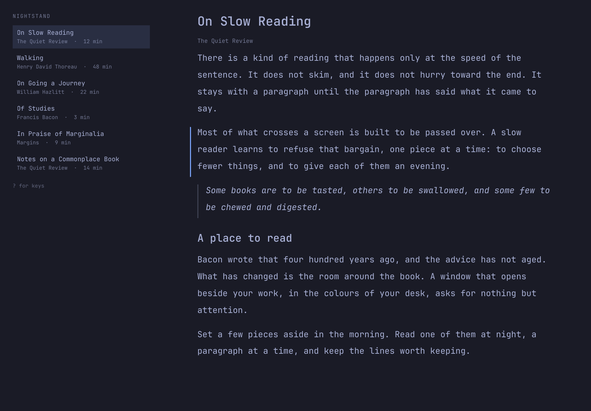

# Noeis for Omarchy

A reader for [Omarchy](https://github.com/omacom/omarchy) 4 ("Quattro").



[Noeis](https://www.noeis.io) is a place to keep what you read: the essays
you mean to get to, the passages worth keeping, and what you come to think
about them. On Omarchy it reads the way the rest of the desktop works, from
the keyboard and in your theme, so it fits here better than a tab does.

The reading window is drawn by the shell. Your nightstand is on the left, the
piece on the right, set in the system font and your theme's colours, and `j`
and `k` walk it a paragraph at a time. It is an ordinary window, so Hyprland
tiles it beside your work. All of noeis.io (Library, Think, Wiki, Judgment,
Editions) opens as an app in a tiled window of its own, and the Noeis mark in
the bar opens a panel where one field takes either a link to save or a search.

## Install

```bash
omarchy plugin add https://github.com/atsokolas/omarchy-noeis --enable
```

That is the whole plugin: the mark on the bar, the panel and the reading
window. The first time, the panel offers **Connect in your browser** (see
[Connecting](#connecting)).

Keys and launcher entries are a separate, optional step, since they change
your own configuration:

```bash
~/.config/omarchy/plugins/io.noeis/bin/noeis-setup
```

It changes exactly these, checks before each so running it again changes
nothing, and [Remove](#remove) undoes every one:

- **`~/.config/hypr/bindings.lua`:** lines under a `-- Noeis` comment.
  Super+Alt+N opens Noeis, Super+Alt+R reads, Super+Ctrl+Alt+N opens the
  panel, Super+Alt+Shift+N saves the clipboard's link, Super+Alt+T saves
  highlighted text, Super+Ctrl+Alt+Print saves text off the screen. A key
  Noeis bound before is moved to its new meaning; check the rest are free
  first with `omarchy menu keybindings --print`. By hand, a binding reads
  `o.bind("SUPER + ALT + N", "Noeis", "noeis-open --web")`.
- **`~/.config/chromium-flags.conf`:** the Noeis browser extension, added to
  `--load-extension`, so Alt+Shift+N in Chromium saves the tab you are
  reading.
- **`~/.config/omarchy/extensions/omarchy-menu.jsonc`:** **Share → Noeis**
  (Super+Ctrl+S), which saves the link on your clipboard.
- **Two launcher entries**, through `omarchy-webapp-install`: **Noeis**, all
  of noeis.io as an app in its own window, wearing your Omarchy theme once
  you choose Omarchy in noeis.io's theme settings; and **Noeis reader**, the
  reading window, which also opens EPUB, PDF and Markdown files into your
  Library. The first fetches noeis.io's icon.
- **`~/.local/bin/noeis-open`:** a link to `bin/noeis-open`, which the
  bindings and launcher entries call.

`omarchy-noeis` is this folder published on its own (with the browser
extension packed beside it) by `.github/workflows/omarchy-plugin.yml`, since
this repository's root is the Chrome extension and `omarchy plugin add`
cannot read it. From a checkout, `cp -r plugins/omarchy
~/.config/omarchy/plugins/io.noeis` does the same, without the extension.

The mark lands on the right of the bar; `omarchy bar move io.noeis --section
left` moves it.

## The reading window

`omarchy-shell noeis read` (Super+Alt+R, or Noeis reader in the launcher)
opens it. It is titled "Noeis", so it moves between workspaces and takes
window rules like any app.

| Key | |
|---|---|
| `j` `k` | Next and previous paragraph; the one you are on is marked in the margin |
| `n` `p` | Next and previous piece in the list |
| `o` | Open the piece on noeis.io |
| `1`–`5` | Library, Think, Wiki, Judgment, Editions in the Noeis app |
| `q` `Esc` | Close |
| `?` | These keys |

The window follows a theme change at once.

## The panel

- **Paste a link** and press Enter to save it to read later. The receipt says
  where the piece actually landed: on your nightstand, on your desk, or
  already yours since the day you saved it. Click the receipt to read it.
- **Type words** and everything you keep answers as you type: the views you
  hold first, then Wiki pages, then sources, passages and notes. Each kind
  gets two rows before any kind gets more, so a search full of sources still
  shows the view it touches. Up and Down move; Enter reads the one you picked
  in the reading window, with the rest of what was found a keypress away. A
  passage opens at the passage.
- **Open the panel with a link on your clipboard** and it is already in the
  field, selected, so Enter saves it and typing replaces it.
- **With the field empty** it lists your nightstand, newest first, so Enter
  reads the next thing. The mark's tooltip says how many wait there.
- Library, Think, Wiki, Judgment and Editions on noeis.io are one click away
  at the foot. **Sign out** ends the connection on the server as well as
  forgetting it here.

Escape clears the field, and closes the panel when the field is empty.

## Saving from anywhere

Each answers with a notification; clicking it reads what was saved.

- `omarchy-shell noeis saveClipboard` (Super+Alt+Shift+N) saves the link on
  your clipboard. After Omarchy's Alt+Shift+L (copy this tab's address), that
  is two keys from a page to your nightstand.
- `omarchy-shell noeis saveSelection` (Super+Alt+T) saves the text you have
  highlighted in any app into your Library.
- `omarchy-shell noeis saveScreenText` (Super+Ctrl+Alt+Print) reads text off
  a part of the screen you pick, with Omarchy's own text capture, and saves it
  the same way.
- `noeis-open <link>` saves a link; `noeis-open <file>` brings an EPUB, PDF
  or Markdown file into your Library.

## What fits tonight

At an hour you choose (8 pm unless you say otherwise, in the widget's
settings), Noeis looks at your nightstand and, if short pieces wait there,
says so: "Two short pieces fit tonight. Notes on craft has waited longest,
12 min." Short is what noeis.io calls short, fifteen minutes or less. When
nothing short waits it says nothing. Clicking it opens that piece in the
reading window.

## Moving around the app

The Noeis window has no address bar and no back button, so the app answers
to keys, the way the rest of Omarchy does. `?` lists them all in the app.

| Key | |
|---|---|
| `g` then a room's initial | Library, Think, Wiki, Editions, Judgment (`l` `t` `w` `e` `j`); `c` Connections, `s` Settings |
| `[` `]` | Previous and next room, in the masthead's order |
| `j` `k` | Next and previous item in the room's list |
| `Enter` | Open the item you are on |
| `h` or `Alt+←` | Back; `Alt+→` forward |
| `/` | The room's search, or the palette where it has none |
| `Ctrl+K` | The palette |
| `?` | Every key |

Inside a piece, `j` `k` walk its paragraphs instead, and `n` `p` turn to the
next and previous piece.

## Connecting

The first time, the panel offers **Connect in your browser**. It opens
noeis.io, where you approve this desktop the way you approve the Noeis CLI.
The token is kept in `~/.config/noeis/omarchy.json`, which is written `0600`
in a directory made `0700` before anything goes in; the CLI's own
`config.json` beside it is left alone. The token may bring links, files and
text in, search and read what you keep, and see your nightstand, and nothing
else. It lasts until you sign out in the panel or revoke it under Connected
agents on noeis.io; then the panel asks to connect again.

Every request goes to Noeis's API over https only, with a deadline, and an
answer past a size ceiling is dropped before it is read. Requests are made
from QML with `XMLHttpRequest`, and `noeis-open` hands the token to `curl` on
stdin, so it never appears in a process's arguments. Titles, articles and
anything else the server sends are drawn as plain text, clipped, with
control characters removed; nothing loads a remote image.

`NOEIS_API_URL` and `NOEIS_APP_URL` point it at another Noeis server, as they
do for the CLI, as long as it speaks https.

## What it needs

Omarchy 4, which brings all of these:

- `curl`, for `noeis-open`'s file uploads;
- `jq`, to read the session in `noeis-open`;
- `wl-paste` (from `wl-clipboard`), for the clipboard and highlighted text;
- `omarchy-capture-text`, for saving text off the screen;
- Chromium or Google Chrome, for the Noeis app window and the extension.

Like every Omarchy plugin it runs unsandboxed inside the shell, with your
user's permissions.

## Remove

Sign out in the panel first, which ends the connection on the server, or
revoke it at noeis.io under **Connected agents**. Then remove the plugin and
its session:

```bash
omarchy plugin remove io.noeis --yes
rm -f ~/.config/noeis/omarchy.json
```

If you ran `noeis-setup`, undo it:

```bash
sed -i '/^-- Noeis$/d; /^o\.bind(.*[Nn]oeis/d' ~/.config/hypr/bindings.lua
sed -i 's|,[^,=]*/io\.noeis/extension||; s|=[^,]*/io\.noeis/extension,\?|=|; /^--load-extension=$/d' ~/.config/chromium-flags.conf
sed -i '/"trigger.share.noeis"/d' ~/.config/omarchy/extensions/omarchy-menu.jsonc
omarchy-webapp-remove Noeis
omarchy-webapp-remove "Noeis reader"
rm -f ~/.local/bin/noeis-open
```

## Files

| File | What it is |
|---|---|
| `manifest.json` | The plugin's id (`io.noeis`), kinds (`service`, `bar-widget`), entry points and settings |
| `Service.qml` | Noeis for the whole shell: the connection, the API, the nightstand, saving, `omarchy-shell noeis …`, the evening note, the theme |
| `Reader.qml` | The reading window |
| `BarWidget.qml` | The mark in the bar; hosts the panel and hands the Service its settings |
| `Panel.qml` | The panel: connecting, the field, search results, the nightstand, receipts |
| `NoeisMark.qml` | The three-ring mark, drawn natively at bar size |
| `Model.js` | The decisions, tested in node by `scripts/omarchy_plugin.test.js` |
| `bin/noeis-open` | The reading window, links onto the nightstand, files into your Library, and noeis.io itself with `--web` |
| `bin/noeis-setup` | Keys, launcher entries, the extension and the Share menu; optional |
| `preview.png` | The reading window, with demo essays |
| `LICENSE` | ISC |

`omarchy plugin validate plugins/omarchy` checks the folder the way the shell
does before it loads it.

## License

ISC. See `LICENSE`.
